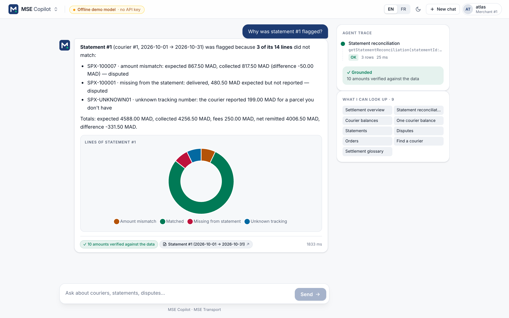
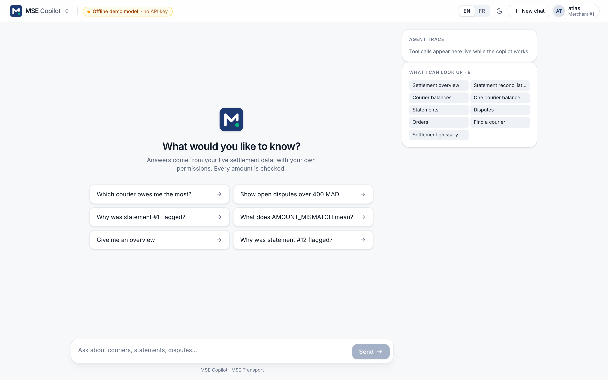
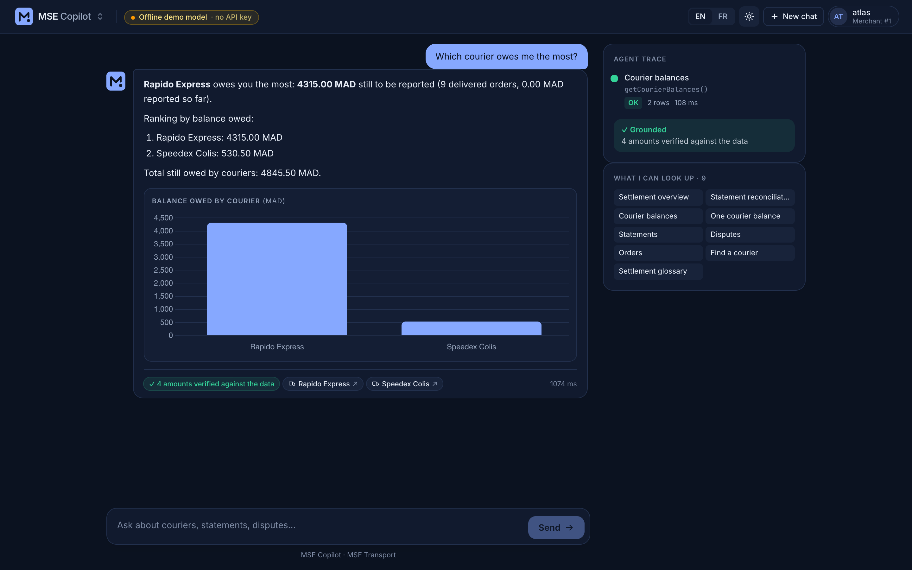
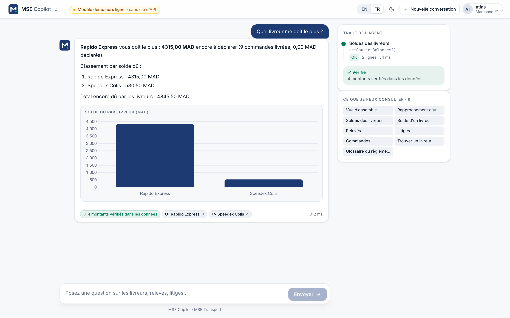
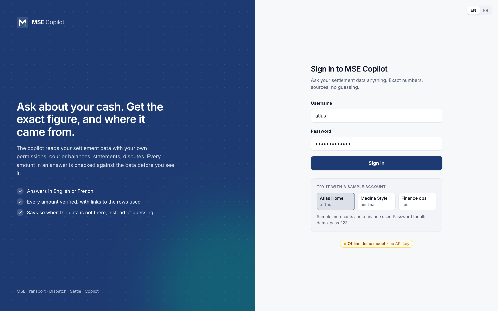
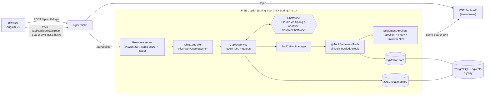
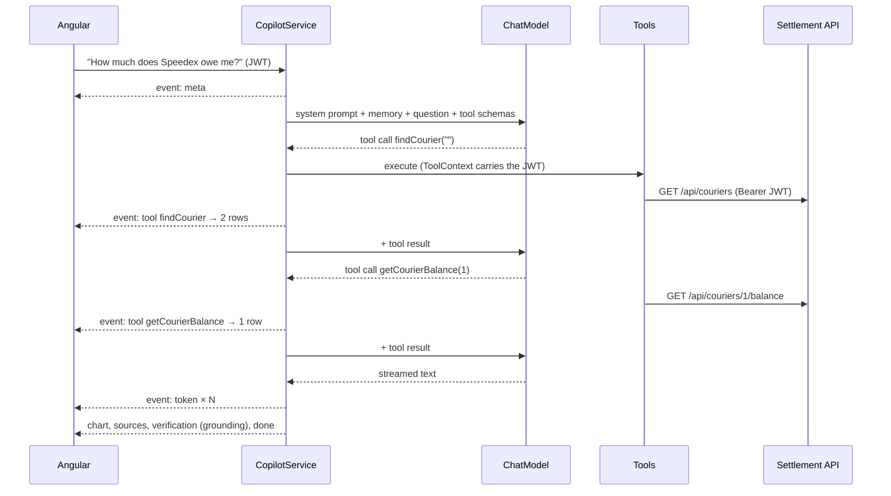

<p align="center"></p>

# MSE Copilot

**Ask your cash-on-delivery settlement data, in English or French.** *"Which courier owes me the
most?"*, *"Show open disputes over 400 MAD"*, *"Why was statement #1 flagged?"*: MSE Copilot answers
with **exact figures**, a **chart**, and **links to the rows it used**. Every amount is checked
against the data before it is shown, and when the data isn't there, it says so instead of guessing.



MSE Copilot is one of the three products of **MSE Transport**, a software suite for cash-on-delivery
logistics in Morocco:

| Product | What it does | Repository |
|---|---|---|
| MSE Dispatch | Live parcel operations: orders, courier assignment, delivery attempts, customer SMS | `spring-parcel-platform` |
| MSE Settle | Courier cash settlement and reconciliation | `spring-cod-settlement` |
| **MSE Copilot** | AI assistant over settlement data (this repository) | `spring-ai-settlement-copilot` |

It calls the MSE Settle REST API **with the user's own token**, so it can never see more than the
user can. Product overview: [`docs/PRODUCT-OVERVIEW.md`](docs/PRODUCT-OVERVIEW.md). Brand system:
[`brand/BRAND.md`](brand/BRAND.md).

Stack: Java 21 · Spring Boot 3.5 · Spring AI 1.1 (Anthropic Claude, tool calling, chat memory,
pgvector) · Spring Security (OAuth2 resource server) · Resilience4j · Flyway · springdoc ·
PostgreSQL 16 + pgvector · Angular 21 (standalone, signals, zoneless) · RxJS · Tailwind · Chart.js ·
JUnit 5 · Testcontainers · WireMock · Vitest · Playwright · Docker Compose · GitHub Actions.

---

## The problem

Merchants and finance teams using MSE Settle have their answers in the data (courier balances,
reconciled statements, disputes) but finding them means knowing which screen, filter and export to
use. Generic chatbots are the wrong fix: they guess numbers, and in a cash business a wrong figure
said confidently is worse than no answer. MSE Copilot answers only from the user's own data, through
the same API and permissions as the app, and proves every amount it states.

## What it does

| You ask | The copilot does | You get |
|---|---|---|
| Which courier owes me the most? | `getCourierBalances()` | "**Rapido Express** owes you the most: **4315.00 MAD**…", a bar chart, one source chip per courier |
| How much does Speedex owe me? | `findCourier("")` then `getCourierBalance(1)` | expected, reported, fees, net remitted, **530.50 MAD** owed |
| Why was statement #1 flagged? | `getStatementReconciliation(1)` | the 3 non-matched lines with expected/collected/difference, a doughnut chart, a link to the statement |
| Show open disputes over 500 MAD | `listDisputes(OPEN, 500)` | "none over 500.00 MAD; you have 2, the largest claims 480.50 MAD" |
| Que signifie MISSING_FROM_STATEMENT ? | `searchSettlementDocs(...)` (RAG) | the definition, from the docs, in French |
| Why was statement #12 flagged? | `getStatementReconciliation(12)` → 404 | "I couldn't find statement #12… I won't guess" |
| Which courier will owe me the most next month? | nothing | a polite refusal: there is no data about the future |

Every answer ends with a **grounding check**: each amount in the text must appear in the data the
tools returned during that turn. The UI shows "✓ 4 amounts verified against the data", or a red
warning if a model ever invents a figure.

## Highlights

- **Spring AI tool calling** over a real API: 9 read-only `@Tool` methods; the user's JWT travels
  through Spring AI's `ToolContext` (the model never sees it) and is forwarded to the platform,
  which enforces tenant isolation.
- **Explicit, streamed agent loop**: model → tool calls → results → model, at most 5 rounds, every
  step streamed to the browser as Server-Sent Events (`meta`, `tool`, `token`, `chart`, `sources`,
  `verification`, `done`).
- **Two interchangeable chat models**: Claude (`claude-opus-5-5` by default) when
  `ANTHROPIC_API_KEY` is set, and an **offline scripted `ChatModel`** otherwise, so local runs, the
  tests and CI need no key. Both run through the exact same loop, tools and guards. The UI badge
  always shows which one is answering.
- **RAG on pgvector** over the platform's own documentation (business rules, formulas, glossary),
  with offline deterministic embeddings and a hybrid (vector + IDF keyword) re-rank.
- **Guardrails in code**, not only in the prompt: prompt-injection neutralizer for text inside the
  data, grounding check for numbers, input validation, read-only tools, max tool rounds.
- **Chat memory** per user and conversation (Spring AI `MessageWindowChatMemory` on JDBC).
- **Resilience**: timeouts, retries with exponential backoff on 5xx, circuit breaker, and a clear
  "the platform isn't reachable" answer instead of a stack trace.
- **AI evaluation suite** with a **quality gate** in `mvn verify`: 23 golden questions (EN + FR).
- **Angular web app**: token streaming, live agent trace, charts from a server-built spec, source chips
  that deep-link into MSE Settle, EN/FR, light/dark, and the suite shell (product switcher, user menu).

## Screens

| Welcome and suggestions | Courier ranking (dark mode) |
|---|---|
|  |  |
| **The same question in French** | **Sign in** |
|  |  |

## Architecture



One question, step by step:



```
src/main/java/com/msetransport/copilot/
  chat/        CopilotService (agent loop), PromptBuilder, ChartSpecFactory, events, Language
  tools/       SettlementTools (@Tool), TurnContext, TracingToolCallback, tool outputs
  knowledge/   HashingEmbeddingModel, KnowledgeIngestor, KnowledgeTools (RAG), TextNormalizer
  guard/       InjectionGuard, GroundingGuard
  settlement/  SettlementApiClient (RestClient, Resilience4j), DTOs, desk deep links
  security/    resource server config, token type validator, Caller
  demo/        ScriptedChatModel, DemoPlanner, AnswerRenderer (offline model)
  web/         ChatController (SSE + JSON), conversations, info, ProblemDetail errors
  config/      properties, mode selection, Spring AI beans, OpenAPI
src/main/resources/knowledge/   the documentation indexed for RAG
src/main/resources/db/migration Flyway: vector_store (HNSW index), chat memory
web/                            Angular app (+ nginx.conf, Playwright e2e)
```

## Run it (one command, no API key)

Prerequisites: Docker, and the MSE Settle repository (`spring-cod-settlement`)
cloned next to this one (`../spring-cod-settlement`; it is built, never modified).

```bash
docker compose up --build -d
open http://localhost:3300
```

Sign in with a sample account (password `demo-pass-123`):

| User | Role | Try |
|---|---|---|
| `atlas` | merchant (Atlas Home) | the suggestion chips; "And Rapido?" as a follow-up |
| `medina` | merchant (Medina Style) | "Why was statement #1 flagged?" (not hers: refused) |
| `ops` | finance staff | "Show open disputes" (sees every merchant) |

| URL | What |
|---|---|
| http://localhost:3300 | MSE Copilot web app |
| http://localhost:18090/swagger-ui.html | Copilot API docs |
| http://localhost:3201 | MSE Settle web app, where source chips link |
| http://localhost:18081 | MSE Settle API |

A one-shot `settlement-seed` container uploads the sample remittance CSV and opens two disputes, so
there is something to ask about. `docker compose down -v` removes everything.

**Try it (2 minutes):** sign in as `atlas`, click *Which courier owes me the most?* (watch the
trace panel and the tokens stream), type *And Rapido?* (memory), click *Why was statement #1
flagged?* and open the source chip, switch to **FR** and ask *Quel livreur me doit le plus ?*, then
sign in as `medina` and ask about statement #1.

## Run with Claude

```bash
cp .env.example .env      # then set ANTHROPIC_API_KEY=... yourself in .env (git-ignored)
docker compose up -d --build copilot
```

`COPILOT_MODE=auto` (default) picks Claude when a key is present; the badge switches to
"Claude · claude-opus-5-5". `ANTHROPIC_MODEL` changes the model. Nothing else changes: same tools,
guards, memory and UI.

## Local development

```bash
docker compose up -d vector-db settlement-api settlement-seed      # dependencies
APP_JWT_SECRET=local-docker-only-secret-change-me-0123456789 \
SETTLEMENT_API_URL=http://localhost:18081 PORT=18090 ./mvnw spring-boot:run
cd web && npm ci && npm start                                       # http://localhost:4200, proxies /api
```

## Tests and evaluations

```bash
./mvnw test                 # unit + slice tests (no Docker)
./mvnw verify               # + Testcontainers (pgvector) + WireMock ITs + AI evals + JaCoCo gate
open target/eval/report.md target/site/jacoco/index.html
cd web && npm test          # Vitest
cd web && npm run e2e       # Playwright against the compose stack (PW_CHANNEL=chrome to use local Chrome)
```

| Layer | Tool | Count |
|---|---|---|
| Guards, retrieval, planner, renderer, tools, client, agent loop | JUnit 5, Mockito, AssertJ, WireMock | 135 |
| Controllers + real security chain (401s, forged/expired/refresh tokens, SSE) | `@WebMvcTest` | 10 |
| Full app on pgvector (Testcontainers) + settlement API in WireMock: chat flow, SSE over HTTP, tenant isolation, retries/circuit breaker, RAG, Claude path | `@SpringBootTest` | 18 |
| AI evaluation suite: 23 golden questions EN/FR | `EvalSuiteIT`, gate ≥ 95 % | 1 (23 cases) |
| Angular services and components | Vitest | 40 |
| Browser e2e on the compose stack | Playwright | 4 |

Backend line coverage is **98 %** (gate: 85 %); web line coverage 99 %.

**The eval suite** (`src/test/resources/evals/golden-set.json`) grades each answer on: the right
tools in the right order, the exact numbers, sources attached, refusal for out-of-scope / future /
missing data (with no amounts in the refusal), prompt injection ignored (in the data and in the
question), grounding, and answer language. It writes `target/eval/report.md` and fails the build
below the threshold (`-Deval.threshold=0.95`). In offline mode it is deterministic (100 %); with a key
the same harness can grade Claude.

**The Claude path is tested without a key**: `AnthropicModeIT` points Spring AI's
`AnthropicChatModel` at WireMock, which streams Anthropic-format SSE (`tool_use`, then text). It
proves the loop works with Claude's streaming tool calls and pins the request (model id, tools,
system prompt, no `temperature`).

## API

```bash
TOKEN=$(curl -s -X POST localhost:18081/api/auth/login -H 'Content-Type: application/json' \
  -d '{"username":"atlas","password":"demo-pass-123"}' | jq -r .accessToken)

# streaming (what the UI uses)
curl -N -X POST localhost:18090/api/copilot/chat/stream -H "Authorization: Bearer $TOKEN" \
  -H 'Content-Type: application/json' -d '{"message":"Which courier owes me the most?"}'
# event:meta    data:{"conversationId":"…","mode":"demo","model":"scripted-offline","language":"en"}
# event:tool    data:{"trace":{"tool":"getCourierBalances","status":"OK","rows":2,"durationMs":41,…}}
# event:token   data:{"text":"**Rapido "}            (× N)
# event:chart · event:sources · event:verification · event:done

# one JSON answer (curl, scripts, evals)
curl -s -X POST localhost:18090/api/copilot/chat -H "Authorization: Bearer $TOKEN" \
  -H 'Content-Type: application/json' -d '{"message":"Why was statement #1 flagged?","conversationId":"demo-1"}'

curl -s localhost:18090/api/copilot/conversations/demo-1 -H "Authorization: Bearer $TOKEN"   # memory
curl -s localhost:18090/api/copilot/info                                                   # public: mode, model, tools
```

Errors are RFC 7807 `ProblemDetail` (401 without a valid platform access token, 400 on validation).

## Design decisions

**The copilot has no database access to settlement data.** Tools call the platform's public REST
API with the caller's own token. Tenant isolation, roles and validation stay in one place (the
platform); the copilot cannot leak what the user could not see in MSE Settle anyway. A
merchant asking about another merchant's statement gets the platform's 404 and a refusal.

**The agent loop is explicit.** Spring AI can run tools inside the model call; here
`internalToolExecutionEnabled=false` and `CopilotService` drives the loop with `ToolCallingManager`.
That gives one place to stream each step, trace tool calls, cap the rounds, and run the guards, and
it is identical for Claude and the offline model.

**Numbers are checked, not trusted.** Tools return money as two-decimal strings (`"530.50"`, never a
JSON float that would print `530.5`). `GroundingGuard` extracts every amount from the answer
(including French `4 315,00`) and checks it against the tool payloads of the turn.

**Charts come from data, never from the model.** `ChartSpecFactory` builds the chart from typed
tool outputs, so a chart cannot disagree with the answer.

**Untrusted text is neutralized before the model sees it.** Dispute reasons and customer names are
free text typed by people; `InjectionGuard` replaces instruction-like text ("ignore previous
instructions…", in English or French) and the trace shows "1 suspicious text neutralized". The
system prompt also states that tool results are data. The eval suite has a poisoned dispute.

**An offline model that is a real `ChatModel`.** `ScriptedChatModel` reads the prompt like an LLM
(system prompt, memory, question, tool results) and answers with tool calls or text. It makes local runs
free and the tests deterministic, and it exercises the whole pipeline: if the loop, tools,
SSE or guards break, the tests break.

**Offline embeddings + hybrid retrieval.** `HashingEmbeddingModel` (feature hashing, 384
dimensions, FR→EN domain synonyms) needs no download or key and gives the same vectors everywhere.
It matches words, not meaning, so retrieval takes pgvector's 12 nearest chunks and re-ranks them
with IDF-weighted keyword overlap (a rare word like "formula" counts more than "balance"). A
neural embedding model is a drop-in `EmbeddingModel` bean; the table dimension would change.

**Spring AI 1.1 on Boot 3.5.** Spring AI 2.x requires Spring Boot 4; this project stays on the Boot
line MSE Settle uses. Two adjustments for current Claude models: Spring AI 1.1 defaults
`temperature` to 0.8, which current models reject, so it is removed unless configured; and thinking
blocks are filtered out of the stream.

**Memory is keyed by user + conversation** (`atlas:<id>`): guessing another user's conversation id
returns an empty history. Flyway owns both tables (`vector_store` with an HNSW cosine index, and the
chat memory table with a wider id column); Spring AI's schema initializers are off.

**Known limits.** The real-Claude path is verified against a faithful fake of the Messages API, not
against the live API (no key on the build machine). Spring AI 1.1 does not replay Claude's thinking
blocks between tool rounds; if a model rejects multi-step tool turns because of that, set
`ANTHROPIC_MODEL` to a model that runs without extended thinking by default. The offline planner
understands the common question shapes in the golden set, not arbitrary phrasing.

## License

MIT, see [LICENSE](LICENSE).
