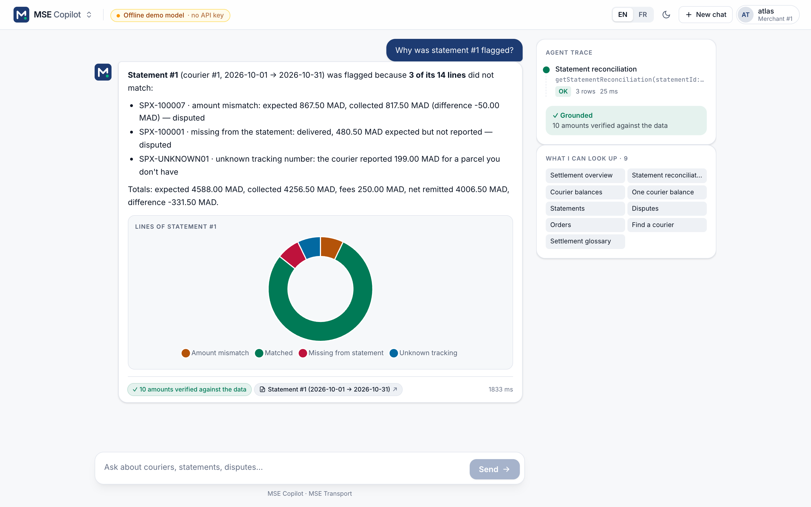
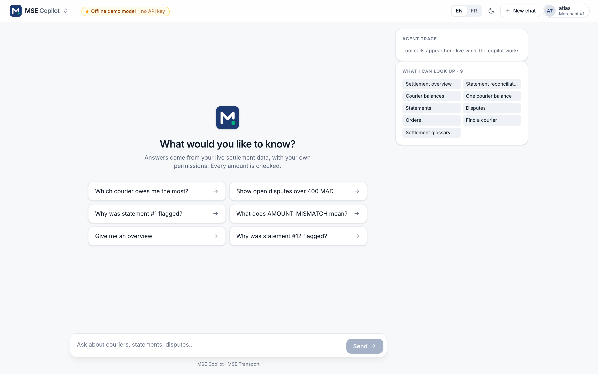
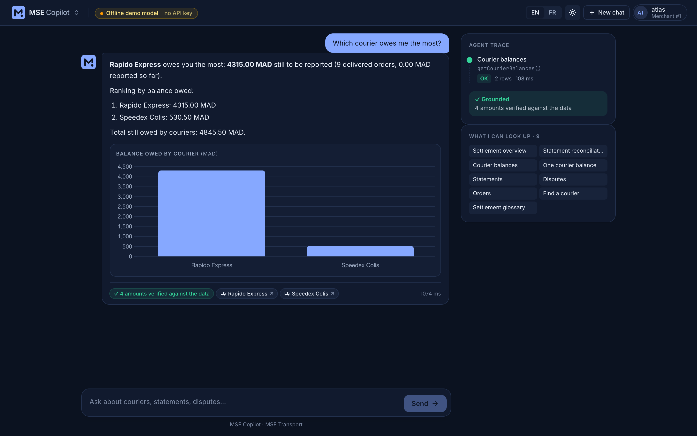

# MSE Copilot: product overview



**MSE Copilot** is the AI assistant of **MSE Transport**, a software suite for cash-on-delivery (COD)
logistics in Morocco (with MSE Dispatch for live parcel operations and MSE Settle for courier cash
settlement).

## The problem

Merchants and finance teams have their answers in MSE Settle (courier balances, reconciled
statements, disputes), but finding one means knowing which screen, filter and export to use. A
generic chatbot is the wrong fix: it guesses, and in a cash business a confident wrong figure is
worse than no answer.

## What MSE Copilot does

- Answers questions in **English or French**: "Which courier owes me the most?", "Show open
  disputes over 400 MAD", "Why was statement #1 flagged?", "What does AMOUNT_MISMATCH mean?".
- Gives **exact figures**, a **chart** and **source links** that open the rows in MSE Settle.
- **Checks every amount** in the answer against the data it fetched, and shows the result.
- **Says so** when the data is missing or the question is about the future, instead of guessing.
- Sees **only what the user can see**: it calls the MSE Settle API with the user's own token.
- Shows its work live: each data lookup, how many rows came back and how long it took.

| Welcome | Courier ranking (dark mode) |
|---|---|
|  |  |

## How it is built

- **Backend**: Java 21, Spring Boot 3.5, Spring AI 1.1 (Anthropic Claude, tool calling, chat memory),
  PostgreSQL 16 + pgvector, Spring Security (OAuth2 resource server), Resilience4j, Flyway.
- **Web app**: Angular 21 (standalone components, signals, zoneless), Tailwind with the MSE
  Transport design tokens, Chart.js; answers stream token by token over Server-Sent Events.
- **Delivery**: Docker Compose (copilot, vector database, web app, and MSE Settle with sample data),
  GitHub Actions CI.

## Key engineering decisions

- **Tools over a real API, not a database connection**: nine read-only Spring AI tools call MSE
  Settle with the user's JWT, passed through the tool context so the model never sees it. Tenant
  rules stay in one place.
- **An explicit, streamed agent loop** (at most five tool rounds), so every step can be shown,
  limited and tested.
- **Guardrails in code**: a grounding check on every amount, neutralised instructions inside the
  data, input validation, read-only tools.
- **Two interchangeable models**: Claude when an API key is set, and an offline scripted model
  otherwise, through the same loop, tools and checks. Local runs and CI need no key; the badge in
  the app always says which one answered.
- **Retrieval over the product's own documentation** (pgvector, hybrid vector + keyword re-rank)
  for definitions and rules.
- **An evaluation suite as a build gate**: golden questions in both languages, graded on tools,
  figures, sources, refusals, injection resistance, grounding and language.

## Quality

| Suite | Count |
|---|---|
| Backend unit and slice tests (JUnit 5, Mockito, WireMock, `@WebMvcTest`) | 145 |
| Backend integration tests (Testcontainers pgvector + WireMock, including the Claude streaming path) | 18 |
| AI evaluation suite: golden questions in English and French, build gate at 95 % | 23 cases, 100 % |
| Web app tests (Vitest) | 40 |
| Browser end-to-end on the full stack (Playwright) | 4 |

Backend line coverage is 98.6 % (gate: 85 %). All suites run in CI.

## Try it

```bash
docker compose up --build -d     # http://localhost:3300, sample account atlas / demo-pass-123
```
