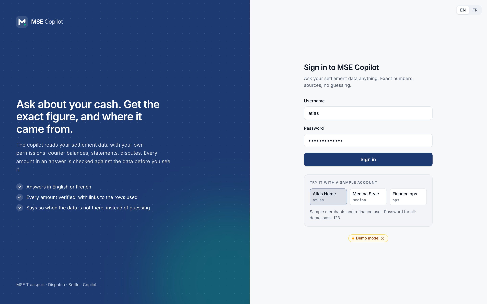
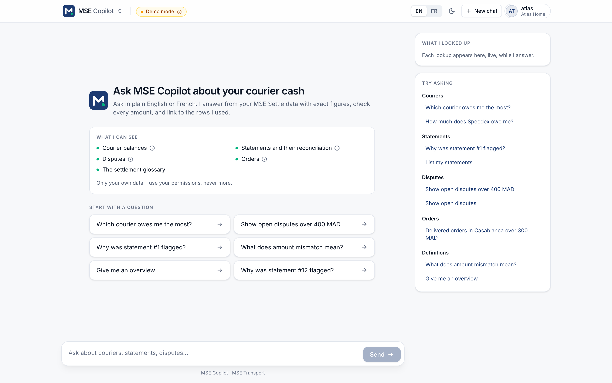
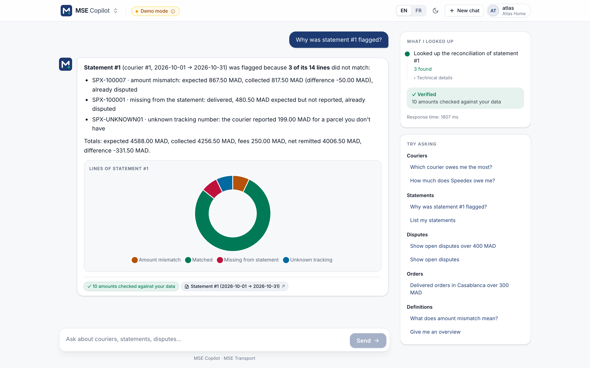
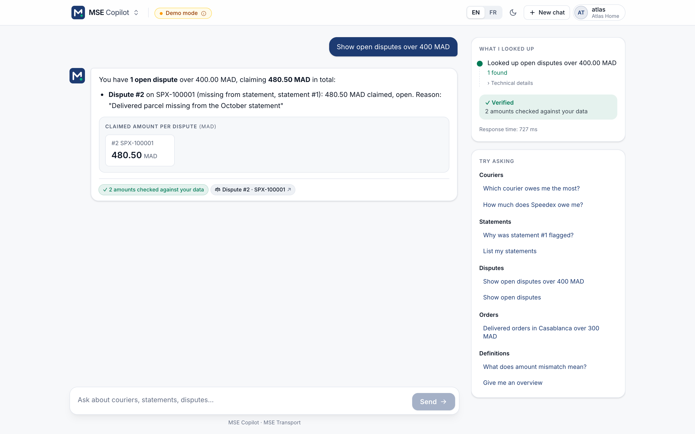
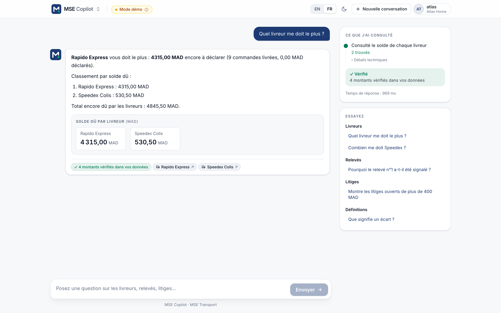
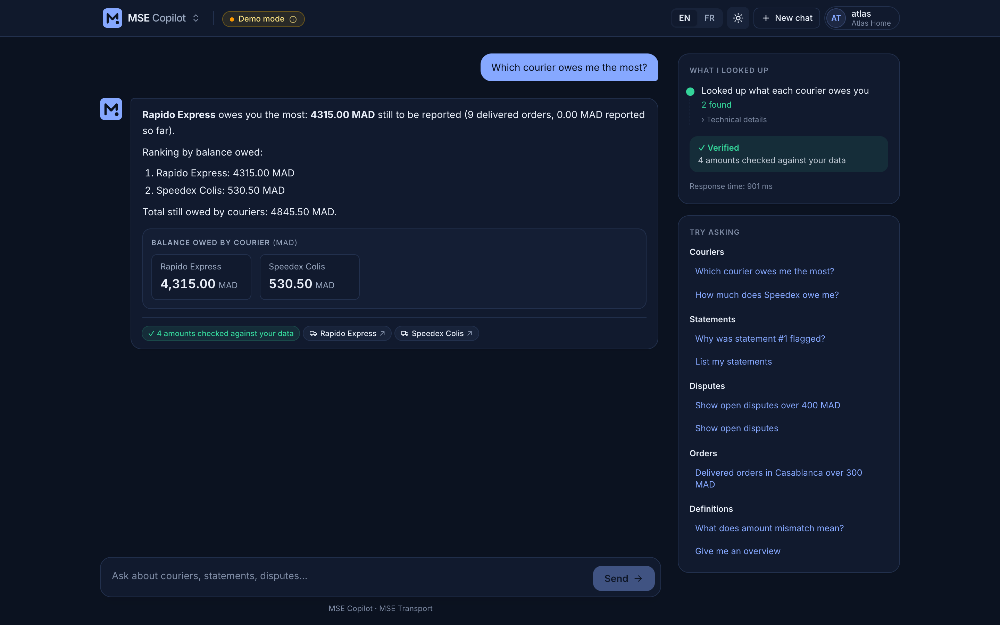
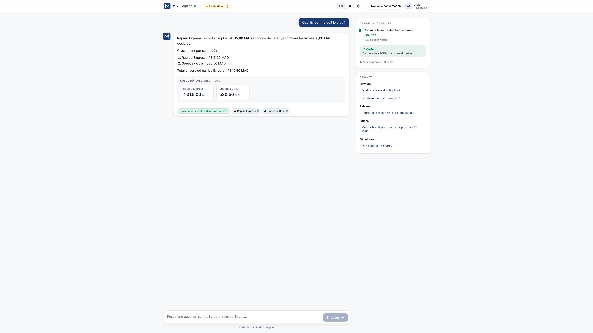

# MSE Copilot: the 2-minute tour

MSE Copilot answers questions about courier cash, from the merchant's MSE Settle data. Start it with
`docker compose up --build -d` (MSE Settle and its sample data start with it) and open
http://localhost:3300.

## 1. Sign in

The sample merchant **Atlas Home** (`atlas`) is filled in; click **Sign in**. The **Demo mode** badge
means answers come from sample data without an AI provider; with an Anthropic API key configured,
the same app answers with Claude.

## 2. Start with a question

The first screen says what the copilot is, what data it can see (hover the ⓘ for definitions) and
offers starter questions. The right panel groups more example questions by topic.

## 3. Ask why a statement was flagged

Click **Why was statement #1 flagged?**. The answer lists the three lines that don't match, with a
chart of all 14 lines. The right panel shows each lookup in plain words (the technical call is one
click away) and how many amounts were checked against the data. The statement link opens it in MSE
Settle.

## 4. Small answers stay small

**Show open disputes over 400 MAD** finds one dispute: the figure is shown as a number, not as a
one-bar chart.

## 5. In French, in the dark

Switch to **FR** and ask *Quel livreur me doit le plus ?*: French wording and French number
formatting. The moon icon switches to dark mode.

## 6. It only sees your data

Sign out, sign in as **Medina Style** (`medina`) and ask about statement #1: it belongs to another
merchant, so the copilot says it can't find it, and shows "No matching records" instead of claiming
anything was verified.

On a wide screen the conversation and the side panel stay centred:

